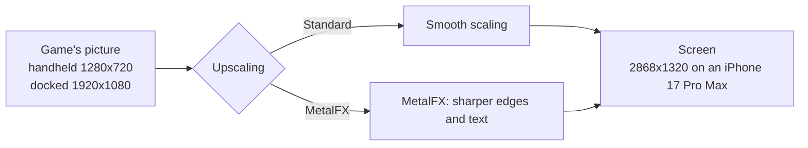
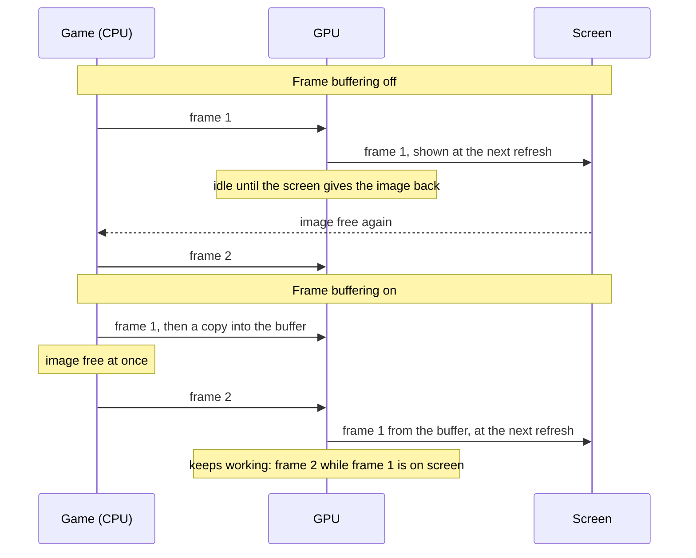
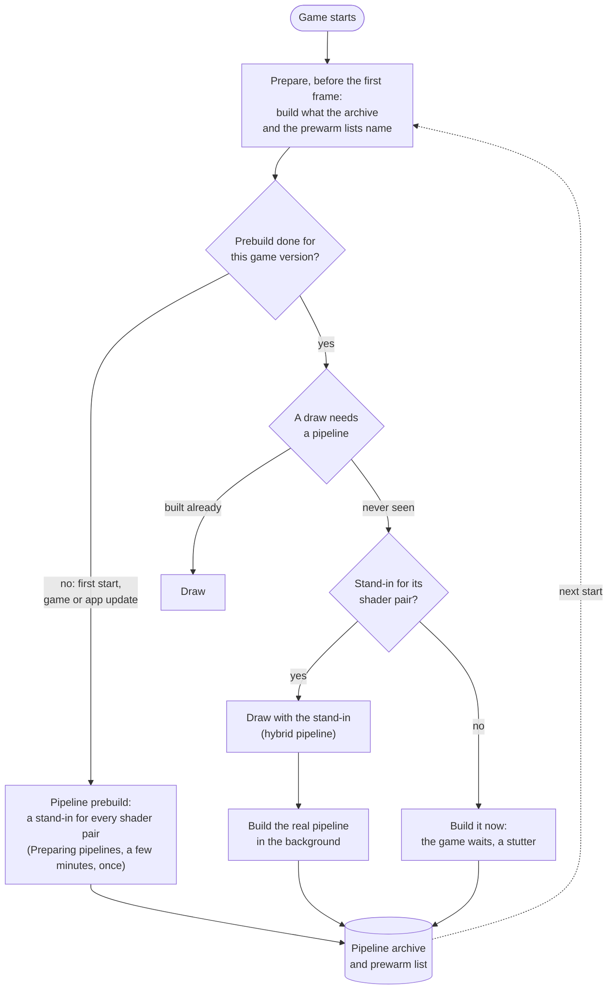
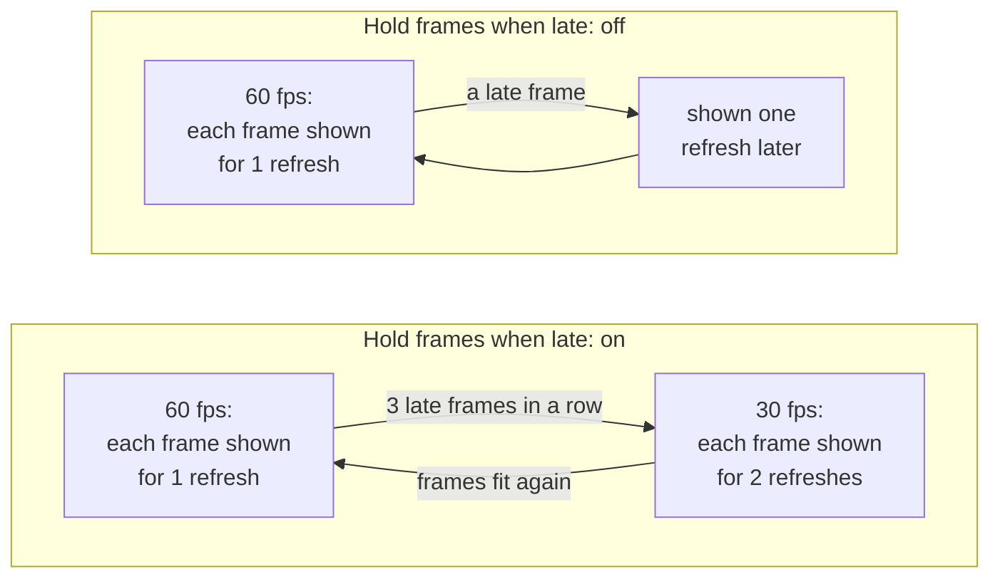

# Settings

The screen before the game starts shows the settings the game supports. A setting that only matters while another is on appears under it and disappears when that one is turned off. Tap **Play** to start; the app remembers your choices for the next start. All settings are on one scrollable screen, under **Game**, **Controls** and **Performance**. Tap a menu or move a slider there; no settings page needs opening. **Upscaling** is in **Game**, beside **Console mode**. A Mac app shows the same settings in a [window of its own](#the-mac-settings-window).

- [Tested defaults](#tested-defaults)
- [Game](#game): [Frame rate](#frame-rate), [Render scale](#render-scale), [Console mode](#console-mode), [Upscaling](#upscaling), [Game language](#game-language), [Frame-rate counter](#frame-rate-counter)
- [Controls](#controls): [Touch feedback](#touch-feedback), [Game rumble](#game-rumble), [Rumble strength](#rumble-strength), [Rumble cutoff](#rumble-cutoff)
- [Performance](#performance): [Frame buffering](#frame-buffering), [Metal 4 pipelines](#metal-4-pipelines), [Pipeline prebuild](#pipeline-prebuild), [Encode thread](#encode-thread), [Hold frames when late](#hold-frames-when-late), [Performance HUD](#performance-hud), [Reset to tested defaults](#reset-to-tested-defaults)
- [The Mac settings window](#the-mac-settings-window): [Players and controls](#players-and-controls), [Motion on the Mac](#motion-on-the-mac), [Rumble on the Mac](#rumble-on-the-mac), [Hotkeys](#hotkeys), [Display mode](#display-mode)
- [TV](#tv)
- [Settings in a file](#settings-in-a-file)

## Tested defaults

Each game comes with the settings it was tested with: its profile in this repository says, for example, that Breath of the Wild runs with Frame buffering and Metal 4 pipelines on, because that combination held a steady 60 fps on an iPhone 17 Pro Max. Those are the defaults the settings screen shows the first time.

When you change a setting and tap **Play**, the app keeps your choice, also when a later build of the app ships other defaults. A setting you leave at its default is not stored: it follows the defaults of the build you have, so a newer build's tested settings reach you without doing anything. **Reset to tested defaults** at the bottom sets every setting back to its default, and **Play** then forgets your choices, so the game's defaults apply again. For testing, a line in `Documents/env.txt` overrides any setting ([Settings in a file](#settings-in-a-file)).

A Mac app carries the same list (`Contents/Resources/dm/launcher.json`), without the iPhone's own Frame-rate counter and Touch feedback, for a front end that starts the app with the chosen values ([Front ends](frontends.md)).

## Game

### Frame rate

Games whose speed the app controls (Breath of the Wild, Tears of the Kingdom and a few others) offer **30 fps** or **60 fps**. 60 is smoother; 30 is what the Switch ran and uses less power, so the phone stays cooler and the battery lasts longer. The game runs at real speed either way.

### Render scale

The size of the 3D picture, from 50 to 100 %. Below 100 % the size is fixed there and the game's own dynamic resolution is off; 100 % keeps the game's own. Lower can be lighter on the GPU but is blurrier; the HUD and text keep their sharpness. Only games the app can scale offer it.

### Console mode

**Docked** renders at the Switch's TV resolution, **Handheld** at its lower handheld resolution, which is lighter on the phone and can give a higher frame rate.

### Upscaling

A game that renders below the screen's resolution is scaled up to the screen. **Standard**, the default, scales smoothly; **MetalFX** uses Apple's MetalFX upscaler, which sharpens edges and text as it scales.

Breath of the Wild renders 1280x720 in handheld mode. Docked it renders its world at 900p and scales that to 1080p itself, before the app sees the picture. MetalFX works in either mode: handheld saves the most GPU time and heat, docked looks sharper than smooth scaling. Rendering at the screen's resolution stays the sharpest picture, where the GPU can afford it.

- **When to change it:** turn it on if the picture looks soft and the device has GPU time to spare: on a Mac, or on an iPhone in handheld mode at 30 fps. For long sessions at 60 fps on an iPhone leave it at Standard.
- **Cost:** more GPU time each frame, which can increase heat on an iPhone. [Breath of the Wild's measurements](../dm/games/01007EF00011E000/README.md#upscaling-current) cover Mac and iPhone; the matching iPhone Standard run and MetalFX's share of the thermal cost remain unmeasured. Nothing changes while the game's picture is as large as the screen. Unsupported devices and sizes use Standard scaling.
- **On the Mac:** choose **MetalFX** under **Upscaling** in the [settings window](#the-mac-settings-window)'s Advanced settings, or set `DM_PRESENT_UPSCALE=metalfx` in its `env.txt` (off by default). It helps in a large window or on a 4K screen.

### Game language

The game's own languages. The app was packed with one of them; pick another here without repacking.

### Frame-rate counter

Shows the frames per second at the top left.

## Controls

### Touch feedback

A light tap from the phone when you press an on-screen button.

### Game rumble

The game's vibration, on the phone or on a connected controller.

### Rumble strength

How strong the game's vibration is, from 0 to 300 %.

### Rumble cutoff

A controller's vibration weaker than this stays off, and the rest is spread over the full range. Off (0 %) by default. A controller with rotating motors can rumble all the time in a game that sends a quiet texture: Mario Kart 8 Deluxe needs about 45 % to rumble only on crashes and drifts. The phone's own vibration is not affected.

## Performance

These settings change how the app hands frames to the screen and how it prepares the GPU's work. The game's tested defaults are a good start; change them when a game stutters, runs hot, or you want less latency.

### Frame buffering

Each finished frame is copied into a buffer of two images that the screen shows from, so the game can start its next frame at once instead of waiting for the screen to give its image back.

Without it the GPU idles between frames, and iOS reads that idle time as room to spare: it lowers the GPU's clock, and the frames take longer still. On an iPhone 17 Pro Max, Breath of the Wild fell to 30 fps without frame buffering and held 60 with it.

- **When to change it:** turn it off if you notice the controls lag behind and the game holds its frame rate without it.
- **Cost:** up to one frame more latency between your input and the screen (about 28 ms more on an iPhone 17 Pro Max), and two more frame-sized images in memory.

### Metal 4 pipelines

Before the GPU can draw something, the app has to build a *pipeline* for it: the game's shaders compiled for the iPhone's GPU, with the drawing settings. Building one takes tens of milliseconds, so a scene full of new ones stutters. With Metal 4 pipelines the app keeps what it built in a pipeline archive on the phone, and builds most pipelines in a few microseconds from a shared base.

At start, before the game's first frame, the app prepares what it already knows: the pipelines in the archive and those the prewarm lists name (one comes with the game, one grows on the phone as you play); with a warm archive that takes well under a second. A pipeline never seen before is drawn meanwhile with a stand-in for its pair of shaders, a *hybrid* pipeline that reads the draw's vertices in a general way and draws the same picture, while the real pipeline is built in the background and archived for the next start.

- **When to change it:** turn it off only if a game crashes or runs out of memory with it.
- **Cost:** memory for the archive while the game runs, and storage on the phone.

### Pipeline prebuild

Builds a stand-in for every pair of shaders the game has (15,767 for Breath of the Wild) and puts them into the pipeline archive, so that a scene you have never seen has a stand-in for each of its draws instead of a stutter. It runs before the game's first frame, behind a **Preparing pipelines** screen: the first start waits a few minutes for it, once, and so does the first start after a game update or an app update that brings new shaders. Every other start skips it. It needs Metal 4 pipelines.

Built in the background while playing instead, the stand-ins took an iPhone 17 Pro Max's GPU from about 13 to 15–18 ms a frame in Breath of the Wild, so the app does the work up front.

- **When to change it:** turn it off if you don't want to wait at that first start.
- **Cost:** on, a wait of a few minutes once. Off, no wait, but a pipeline seen for the first time makes the game stall briefly while it is built, until the archive holds it.

### Encode thread

The app turns the game's graphics commands into Metal commands on a thread of its own instead of the game's submitting thread, so the game's thread can go on sooner (in Breath of the Wild about 4 ms per frame instead of 8). Frame buffering needs it for games that present their frames from another thread than the one that draws them. It is on by default on the iPhone; on the Mac it is off, where it lowered the typical frame time but made the slowest frames slower.

- **When to change it:** leave it on unless a game misbehaves with it; turning it off is a diagnostic step.

### Hold frames when late

For games whose frame rate the app controls ([Frame rate](#frame-rate)). With 60 fps chosen, each frame is meant to stay on screen for one refresh. When a frame comes late, the app can either slow the game down to 30 fps for a while, or keep 60 and show late frames as they come.

- **On** (the default for most games): an even 30 fps (or 20) in heavy scenes instead of a mix of 30 and 60.
- **Off:** the game keeps aiming at 60; a late frame is shown one refresh later and the next one goes on as usual, so heavy scenes look less even but stay closer to 60 on average.
- **When to change it:** turn it off if the game often falls to 30 fps although it is only slightly late.

### Performance HUD

Apple's performance overlay over the game: frame rate, frame and GPU times, memory. Useful to see what a setting changes; leave it off for play.

### Reset to tested defaults

Sets every setting back to the game's tested default; **Play** then forgets your choices, so those defaults apply, and those of later builds too ([Tested defaults](#tested-defaults)). Settings fixed by `Documents/env.txt` stay as the file says.

## The Mac settings window

A Mac app ([A Mac app](development.md#a-mac-app)) shows its settings in a window before the game starts. In nxnative refreshed, that window has a sidebar of pages, each split into sub-sections:

| Page | What it holds |
|---|---|
| Game | Frame rate, render scale, upscaling, console mode, game language |
| Display | [Display mode](#display-mode), fullscreen style (macOS full screen, or borderless and instant), window size (presets, fit the screen, or where it was last), 16:9 resizing, keep in front, the pointer (always, hidden when idle, never), refresh-rate matching, performance HUD |
| Audio | Volume (0 to 200 %), mute while in the background |
| Performance | The game's tested pipeline and pacing settings, plus display link, frames queued, frame order, the 30 fps hold when hot, hybrid pipelines, prebuild and prepare threads (NVN games) |
| Players | [Who plays with what](#players-and-controls) |
| Controls | [The mapping](#players-and-controls), per player |
| Sticks and Mouse | Per player: each stick's dead zone, outer edge, response curve (with a graph), sensitivity, minimum output and inversion; trigger and stick press points; a key's stick deflection, Walk, turbo rate; the mouse as touchscreen, right or left stick, or gyro, with sensitivity, smoothing and inversion |
| Motion | [Motion](#motion-on-the-mac) for every player, then each player's |
| Rumble | [Rumble](#rumble-on-the-mac) for every player, then each player's |
| Hotkeys | [Hotkeys](#hotkeys) |
| System | Player name, whether the game is told about focus, controllers in the background, the packed DLC |
| Saves and Data | [Cloud saves folder](#cloud-saves-folder), the save, log and app data folders, an `env.txt` editor, save backups, input profiles, settings export and import |
| Advanced | One frame per refresh, memory limit, motion log, extra environment variables |

Every option has a reset button beside it (it is greyed out while the option is at its default, and the line under the option names the default once it has changed). Every page has **Reset Page**, and **Reset All…** at the bottom brings back every default after asking. A dot in the sidebar marks a page with changes. Changes are kept as you make them, so **Quit** keeps them too. A setting fixed by an `env.txt` or by the program that started the app is shown greyed out.

Click **Play** (or press Return) to start the game. **Quit**, ⌘Q or closing the window ends the app without the game. The app remembers your choices for that game, and a game started without the window, from a front end or with the window turned off, uses them too ([Saved choices](frontends.md#saved-choices)).

Turn off **Show this window at launch** to start the game at once with your choices. Hold Option while the app opens to see the window again. `DM_LAUNCHER=0` in the app's `env.txt` (`~/Library/Application Support/nxnative/<title ID>/env.txt`) or in its environment, or opening it with `open <app> --args --no-launcher`, also skips the window; your choices still apply. `DM_SAVED_CHOICES=0` starts with the tested defaults instead.

### Players and controls

**Players** decides which devices each of the eight players uses: the keyboard, the mouse, and a controller. The controller can be **Automatic** (the next free one), **None**, **the n-th controller connected**, or a **controller by name**. Controllers are matched by name first, then by connection order, then in the automatic order, where a controller that reconnects gets its player back. **Every controller plays Player 1** merges them all. The quick setups cover the usual cases: each controller is a player with the keyboard on Player 1 (the default, as in nxnative), the keyboard on its own as Player 1, everything on Player 1, and two players on one keyboard. The page lists the connected controllers, with motion, rumble and battery, the player each will get, and a **Rumble** button to tell them apart.

**Controls** maps every Switch input for the chosen player: A, B, X, Y, L, R, ZL, ZR, +, −, both stick presses, the D-pad, each direction of both sticks, Walk (the left stick at a set deflection while held), Shake, Tilt forward/back/left/right, Turn left/right, and Recenter motion. Each input takes two keys, a mouse button or wheel direction, and two controller elements. Controller elements are named by position (on a Nintendo controller, East is A) and include the paddles and the touchpad. Click a cell and press the key, button or stick, or pick one from the list. Any key works, the modifier keys on their own included. A conflict (one key on two inputs, or taken by a hotkey) is marked. Each input can be **Hold**, **Toggle** or **Turbo**. **Presets** applies nxnative's defaults, Switch or Xbox face-button layouts, a keyboard-and-mouse layout with mouse camera, either half of the keyboard, or clears the keyboard or the controller. **Copy from** takes another player's mapping.

Input profiles (**Saves and Data**) keep every player's controls, devices, sticks, mouse, motion, rumble and hotkeys in `~/Library/Application Support/nxnative/profiles/`, where every game can load them.

The window writes the mapping as `input.json` beside the save and gives it to the game as `DM_INPUT_CONFIG`. Without one, the game uses nxnative's controls (WASD, the arrow keys, J K U I, Q E Z C, F G, Return, Tab, Space; the mouse as the touchscreen; the controller as on the iPhone).

### Motion on the Mac

`DM_MOTION` turns motion on or off for everyone. A Pro Controller's own reports can also be read directly, since macOS reports no gyro for it. Under it are tilt drift correction, the accelerometer's direction, and the axis mapping (`DM_MOTION_AXES`). Each player chooses where motion comes from: the controller's gyro (as on a Switch), the mouse (when the mouse is that player's gyro), the tilt keys, or nowhere. The player can also set gyro sensitivity, invert pitch, roll or yaw, and adjust the emulated controller's tilt angle, tilt speed, turn speed and how fast it levels again. Every player can shake (the Shake binding). Recenter, as a binding or a hotkey, levels the controllers and removes gyro drift.

### Rumble on the Mac

Game rumble, its strength and its cutoff apply to everyone. Each player then has rumble on or off, a strength, the low (160 Hz) and high (320 Hz) bands of HD Rumble separately, a cutoff, and swapped motors. **Try it on** plays a short low-then-high pulse on a connected controller at those settings. The game's two motors stay apart on a controller with left and right handles (DualSense, Xbox) and on a DualShock 4.

### Hotkeys

Actions for the app itself, each on two keys and a controller element: toggle fullscreen (in the chosen style), capture or release the mouse (Esc by default; a click in the game also captures it while a player's mouse is a stick or a gyro), mute, volume up and down, recenter every player's motion, the performance HUD, and quit. A hotkey's key does not reach the game. A short message over the game confirms volume, mute, recentering and capture.

### Display mode

**Window** or **Fullscreen**: how the game's window opens. ⌃⌘F or the green button changes it while you play. In an `env.txt`: `DM_FULLSCREEN=1` or `0`.

### Cloud saves folder

**Choose a folder…** picks the iCloud Drive folder the game's save is synced through, the one the iPhone app chose in its launcher's **Cloud saves**, or the game's own folder inside it, named after its title ID ([Cloud saves](#cloud-saves)); **Turn off** stops it. Off by default. macOS may ask once whether the app may open iCloud Drive; if the game log says `this app may not open iCloud Drive`, allow it in System Settings › Privacy & Security › Files and Folders. In an `env.txt`: `DM_SAVE_SYNC=<folder>`, or `DM_SAVE_SYNC=icloud` for iCloud Drive › nxnative Saves; the window then shows it fixed.

## Cloud saves

The Mac app and the iPhone app of one game can share a save through iCloud Drive. Choose the same iCloud Drive folder on both: **Cloud saves** › **Choose a folder…** in the Mac settings window, and **Cloud saves** in the iPhone launcher (any folder, for instance one named **nxnative Saves**). Each game keeps one file there, `<title ID>/save.dmsync`, which holds the whole save.

When the game starts, it brings the save from iCloud Drive in if that one is the one to keep; a few seconds after the game saves, it sends its save. The iPhone app also sends when it goes to the background, and the Mac app once the game has quit. If you played on both without the save getting across in between, the newer save wins.

A save that is replaced, on the device or in iCloud Drive, is kept first, beside the save in a folder named after it with `-backups` (on the iPhone `save-backups` in the Files app, under the app's name; on the Mac `~/Library/Application Support/nxnative/<title ID>/save-backups`): `<date> local` holds this device's save, `<date> cloud` the one that was in iCloud Drive. The newest 10 of each kind stay, and older ones are removed; other folders you put there are left alone.

iCloud Drive takes a moment to carry a file from one device to the other. Quit the game on one device and give it a few seconds before you start it on the other. Without a connection the game plays on with the save it has and sends it later. The game log says what came in and what went out (lines starting with `save sync:`).

## TV

Connect a TV or monitor by cable, or start Screen Mirroring to an Apple TV or AirPlay TV. The game fills it in 16:9 at up to 1080p and switches to **Docked**; the iPhone or iPad keeps the controls. Disconnect to bring the game back to the device in its earlier mode. AirPlay adds some delay; a cable has almost none.

## Settings in a file

A line like `DM_PRESENT_SNAP=0` in `Documents/env.txt` (in the Files app, under the app's name) sets a setting from the file: the settings screen shows it greyed out, and the file wins over your choice and the game's default. Fully close and reopen the app after editing the file. The variables:

| Setting | Variable | Values |
|---|---|---|
| Frame rate | `DM_FPS_TARGET` | `30`, `60` |
| Render scale | `DM_RENDER_SCALE` | `0.5` to `1.0` |
| Console mode | `DM_OPMODE` | `1` docked, `0` handheld |
| Game language | `DM_LANG` | a language code, such as `ja` |
| Display mode (Mac) | `DM_FULLSCREEN` | `1` fullscreen, `0` a window |
| Fullscreen style (Mac) | `DM_FULLSCREEN_STYLE` | `space`, `borderless` |
| Window size (Mac) | `DM_WINDOW_SIZE` | `1280x720` (any `WxH`), `fit`, `remember` |
| Keep 16:9 when resizing (Mac) | `DM_WINDOW_ASPECT` | `1`, `0` |
| Keep the window in front (Mac) | `DM_WINDOW_TOP` | `1`, `0` |
| Pointer over the game (Mac) | `DM_CURSOR` | `show`, `auto`, `hide` |
| Refresh-rate matching (Mac) | `DM_SCREEN_MATCH` | `1`, `0` |
| Volume (Mac) | `DM_VOLUME` | `0` to `2` |
| Mute in the background (Mac) | `DM_BG_MUTE` | `1`, `0` |
| Controllers in the background (Mac) | `DM_BG_INPUT` | `1`, `0` |
| Tell the game about focus (Mac) | `DM_FOCUS_EVENTS` | `1`, `0` |
| Use the packed DLC (Mac) | `DM_AOC_OWNED` | `1`, `0` |
| Player name (Mac) | `DM_NICK` | text, at most 32 bytes |
| Motion controls (Mac) | `DM_MOTION` | `1`, `0` |
| Pro Controller motion (Mac) | `DM_MOTION_HID` | `1`, `0` |
| Tilt drift correction (Mac) | `DM_MOTION_GAIN` | `0` to `2` |
| Input mapping (Mac) | `DM_INPUT_CONFIG` | the path of an `input.json` |
| Cloud saves folder (Mac) | `DM_SAVE_SYNC` | a folder; `icloud`: iCloud Drive › nxnative Saves; `0`: off |
| Frame-rate counter | `DM_SHOW_FPS` | `1`, `0` |
| Touch feedback | `DM_TOUCH_HAPTICS` | `1`, `0` |
| Game rumble | `DM_RUMBLE` | `1`, `0` |
| Rumble strength | `DM_RUMBLE_GAIN` | `0` to `3` |
| Rumble cutoff | `DM_RUMBLE_MIN` | `0` to `0.9` |
| Upscaling | `DM_PRESENT_UPSCALE` | `off`, `metalfx` |
| Frame buffering | `DM_PRESENT_SNAP` | `1`, `0` |
| Metal 4 pipelines | `DM_PSO_MTL4` | `1`, `0` |
| Pipeline prebuild | `DM_PSO_PREBUILD` | `1`, `0` |
| Encode thread | `DM_NVN_ENC_THREAD` | `1`, `0` |
| Hold frames when late | `DM_FPS_HOLD` | `on`, `off` |
| Performance HUD | `DM_METAL_HUD` | `1`, `0` |

`DM_LAUNCHER=0` skips the settings screen; the choices you saved there still apply. `DM_SAVED_CHOICES=0` starts with the tested defaults and keeps your saved choices for later. How the settings are listed for each game: [dm/games/settings.tsv](../dm/games/settings.tsv).
